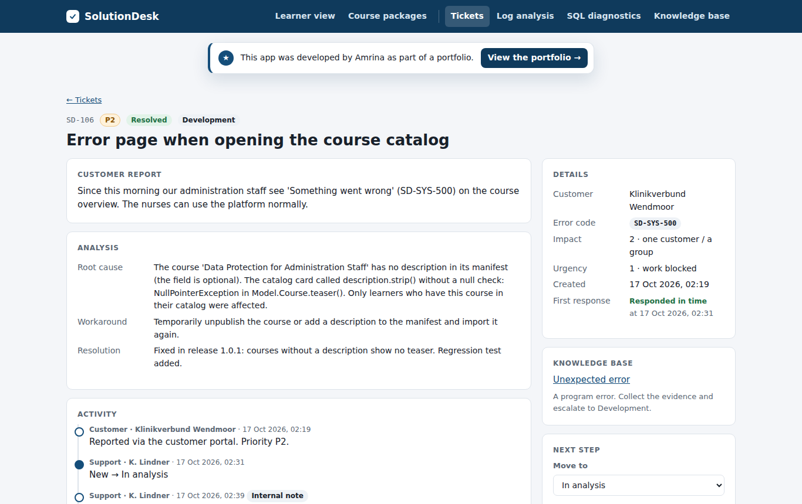

# SolutionDesk

[](https://github.com/sayamrina/solutiondesk/actions/workflows/ci.yml)

**AI project 2026** · [Project page](https://sayamrina.github.io/solutiondesk/) · [Portfolio](https://sayamrina.github.io/)

A small digital learning platform and the support desk behind it. Learners take courses and quizzes; customers import courses as XML packages. When something goes wrong, every error carries an **error code** and a **request ID**, and support works the incident with structured logs, read-only SQL diagnostics and a knowledge base, then resolves it or escalates it to Hosting or Development.



## What it covers

| Skill | Where to see it |
|---|---|
| **Java** | Spring Boot 3 application (Java 21): services, JDBC repositories, controllers, error handling |
| **SQL** | Schema with constraints and indexes, plain SQL repositories, six parameterised diagnostic queries |
| **XML** | Course package importer: encoding check, well-formedness, required fields, item/resource references, DOCTYPE/XXE blocked |
| **HTML / CSS** | Server-rendered Thymeleaf pages, responsive layout, accessible forms |
| **Log and error analysis** | logfmt logs with request ID, error code, owner team, path, status and duration; error groups, search and request trails |
| **Incident handling (Jira-style)** | Tickets with impact × urgency priority, first-response targets, workflow rules, escalation, root cause / workaround / resolution, Jira CSV export |
| **Knowledge base** | One article per error code: symptom, cause, how to check, workaround, when to escalate |
| **Working with other teams** | Each error code has an owner (Support, Hosting, Development); escalation needs a note with the evidence |

## How to use it (about six minutes)

1. **See the problem as a learner:** open *Learner view*, switch to *Sam Richter* and click the course link `KWM-HY-201`. The error page shows `SD-CRS-001` and a request ID.
2. **Pick up the ticket:** in *Tickets*, open **SD-104**. The request trail shows the reason from the log.
3. **Confirm with SQL:** the knowledge base article links to the diagnostic *Why can't a learner see a course?*. Its verdict column says `group mismatch`.
4. **Resolve:** move the ticket to *In analysis*, then *Resolved*, with root cause and resolution. The rules refuse a resolution without a root cause.
5. **Try the others:** SD-108 (broken XML package, reproduce it in *Course packages*), SD-103 (expired enrollment), SD-107 (escalated to Hosting). Export everything with *Export for Jira (CSV)*.

## The incidents

| Ticket | Error | Root cause | Who fixes it |
|---|---|---|---|
| SD-101 | SD-IMP-003 | identifier `f2` vs `F2`: references are case-sensitive | customer, guided by support |
| SD-102 | SD-IMP-004 | file declared UTF-8 but saved as Windows-1252 (`ü` = `0xFC`) | customer, guided by support |
| SD-103 | SD-QZ-002 | enrollment expired, result not stored | customer's training coordinator |
| SD-104 | SD-CRS-001 | course made for group *Pflege*, learner is in *Verwaltung* | customer decision |
| SD-105 | – | percentage computed with integer division: 2/3 → 0 % | Development (commit `1faa067`) |
| SD-106 | SD-SYS-500 | `NullPointerException` for a course without description | Development (commit `c2e402c`) |
| SD-107 | SD-UPL-001 | upload limit of 256 KB on the server | Hosting |
| SD-108 | SD-IMP-001 | unclosed `<resource>` element in the package | open, for you to solve |

The two code bugs (SD-105, SD-106) were **planted on purpose** in the first commit and fixed in the next two commits, each with a regression test that fails before the fix. The git history shows the whole path from incident to fix.

## Design notes

- **Every failure is logged once, centrally.** `GlobalExceptionHandler` and a fallback `/error` controller write known errors as WARN and unexpected ones as ERROR with the stack trace, always with the request ID that the user sees.
- **The sample data is real traffic.** At startup, `SampleData` imports the packages and replays learner and import actions through the real services. The request IDs in the open tickets point to these log events.
- **No free SQL console.** Support runs reviewed, parameterised, read-only queries. A free console on a customer-facing system would be a data protection and security risk.
- **Uploads are treated as hostile.** DOCTYPE declarations are rejected (no XXE), lesson HTML is reduced to a small allowlist of tags, and uploads are limited in size.

## Run it

```bash
# Java 21 and Maven
mvn spring-boot:run          # http://127.0.0.1:8090
mvn verify                   # 37 tests

# or with Docker
docker build -t solutiondesk .
docker run -p 8080:8080 solutiondesk
```

The database is an in-memory H2 (PostgreSQL mode), so every restart starts with fresh sample data.

## Structure

```
common/     error codes and the domain exception
learning/   XML manifest parser, HTML sanitiser, course import, quiz scoring, SQL repository
logging/    request ID filter, structured log buffer, incident logger, log analyzer
support/    tickets and workflow, priority matrix, knowledge base, SQL diagnostics, Jira export
web/        controllers, error handling, templates helpers
resources/  schema.sql, sample customers and learners, course packages (valid and broken), kb articles, templates
```

All companies, people and courses are sample data.

This app was built by Amrina, with AI as a supporting tool for coding.
